<div align="center">


# md2

**Write once in Markdown, publish to WeChat, Zhihu, Xiaohongshu and X / Threads, and get long images and covers too.**

**English** · [简体中文](README.zh-CN.md)

[Web App](https://brycewang-stanford.github.io/md2/) · [VS Code extension](#vs-code-extension) · [CLI](#cli) · [MCP / AI agents](#mcp--ai-agents)

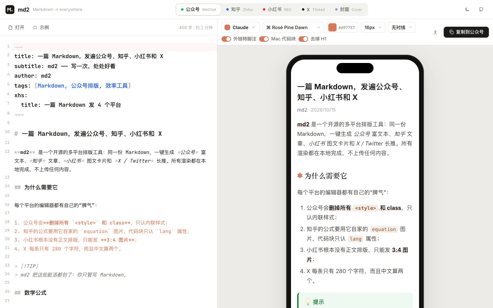

</div>

## Why md2

Every platform's editor has its own quirks. md2 handles them all in one pass:

| Platform | What md2 produces | How it gets there |
| --- | --- | --- |
| **WeChat Official Account (公众号)** | Rich text with every style inlined, copied in one click, or a draft created through the API | A specificity-aware CSS inliner (respects `!important`), formulas as SVG, external links turned into numbered references (WeChat blocks outside links), code that keeps its indentation, Mac-style code blocks |
| **Zhihu (知乎)** | Clean semantic HTML, copied in one click | Zhihu's native inline and block equations, `<pre lang>` code blocks, footnotes as Zhihu's **native references** |
| **Xiaohongshu / RED (小红书)** | 1080×1440 image cards, a cover and a caption | **Smart pagination**: splits by paragraph, list item, code line and table row, never leaves a heading stranded, repeats table headers across pages, and treats `---` as a page break. Checks the 20-character title and 1000-character body limits |
| **X / Threads / Bluesky / Mastodon / LinkedIn** | An auto-split thread or a single long post | Each platform's counting rules (X: CJK = 2, URL = 23; Bluesky counts graphemes; Mastodon URL = 23), splits at sentences, `1/n` numbering, images attached where they appear, Unicode-bold headings |
| **Long image** | One 1080 px-wide PNG | For WeChat Moments, Weibo or Xiaohongshu, in the same theme as your article |
| **Cover** | 10 modern templates × 6 sizes | Xiaohongshu 3:4 / 1:1, WeChat 2.35:1 / 1:1, Zhihu 16:9, X 16:9, with the title font sized to fit |

Also included: **Mermaid diagrams** (styles fully inlined, so they survive pasting into WeChat), **math**, **fine-tuning** (first-line indent, justify, line / paragraph / letter spacing, custom CSS), an **AI writing assistant** (bring your own key: Claude, DeepSeek, Kimi, Qwen or Ollama; writes Xiaohongshu titles and captions, rewrites threads, drafts WeChat headlines and digests, and writes cover copy) and a **Chinese / English UI**.

Everything renders locally. The web app runs in your browser and the CLI and VS Code extension run on your machine. Only the AI and WeChat API calls you trigger yourself go over the network.

### 16 contemporary themes + 8 code palettes

The themes follow current design languages: **Claude, Linear, Geist (Vercel), Apple keynote, Editorial, Swiss, Neo-Brutal, Bento, Aurora, Midnight, Matcha, Wabi-sabi, Distill, Coral, Stripe docs and 宋韵 (Song dynasty)**. Code highlighting comes in GitHub Light/Dark, Vitesse, Tokyo Night, Catppuccin and Rosé Pine. Any theme can take a new accent color in one click.

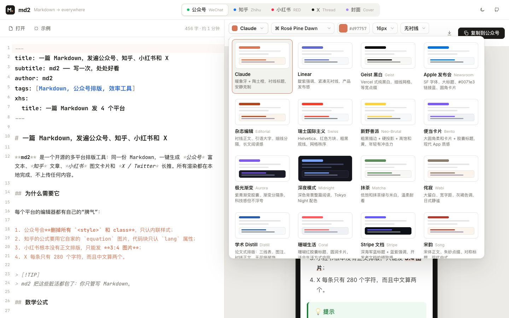

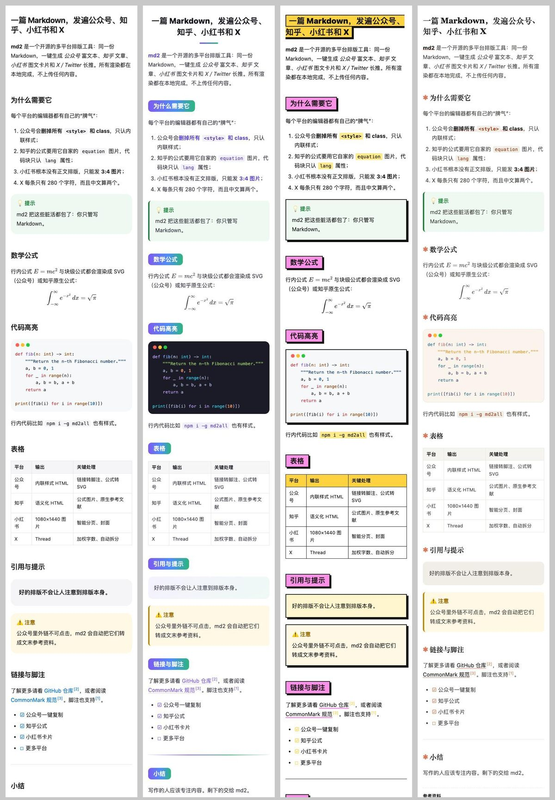

### Xiaohongshu cards

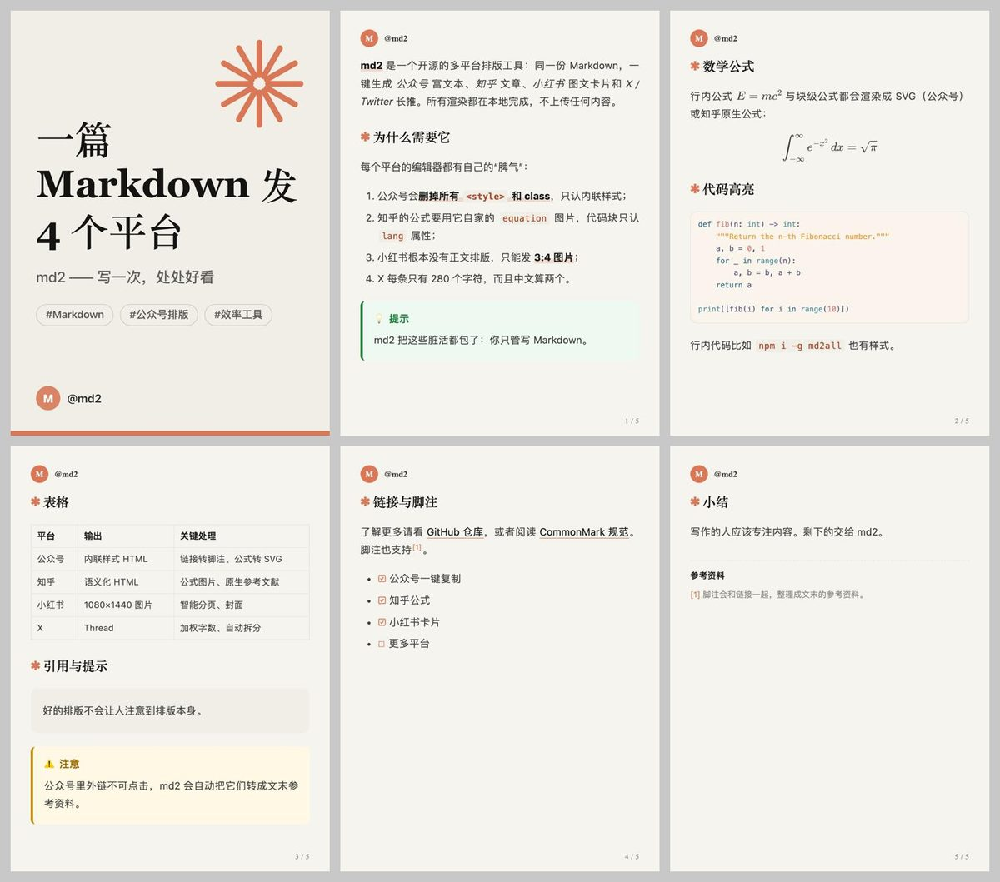

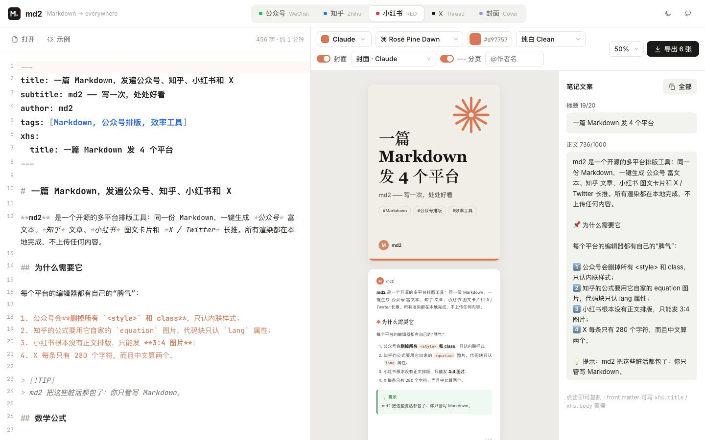

### Covers

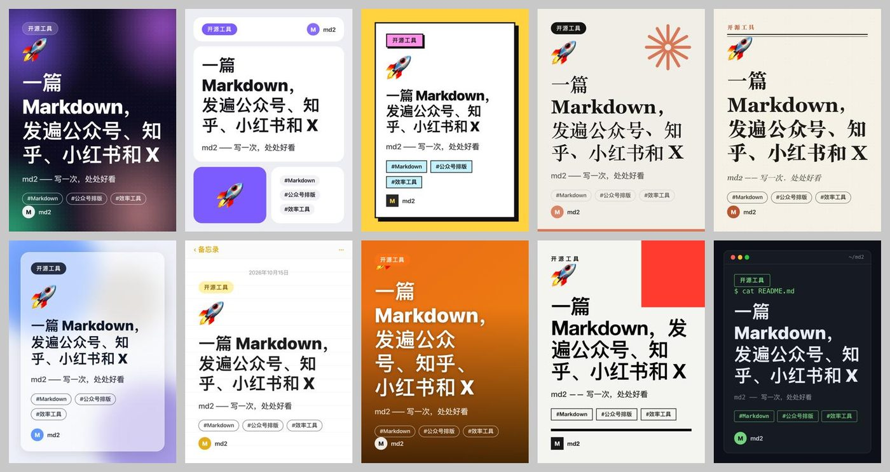

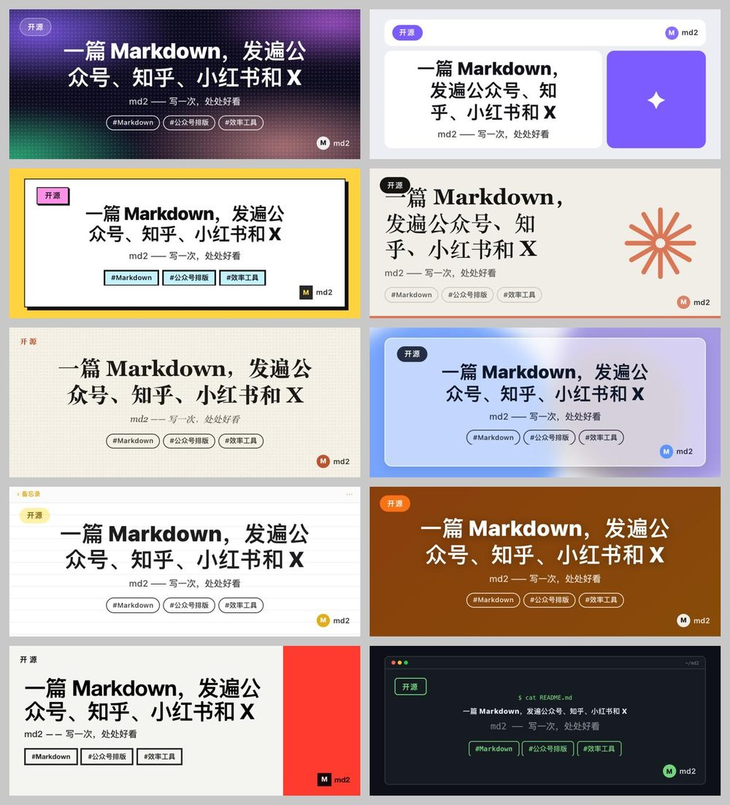

### Zhihu & X

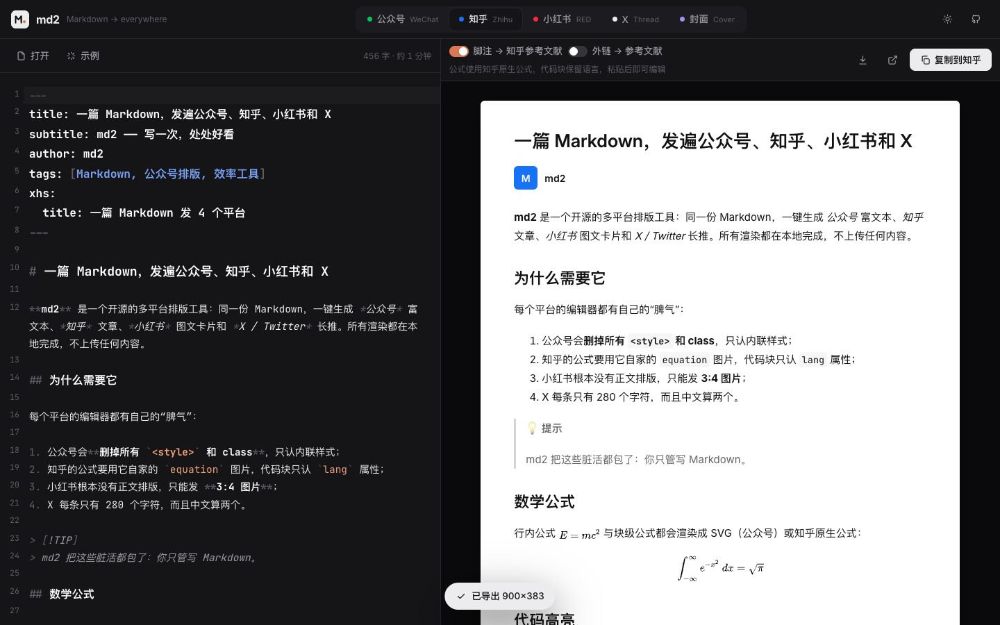

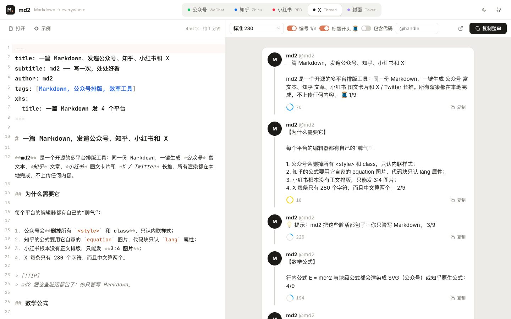

### Mermaid, fine-tuning, AI

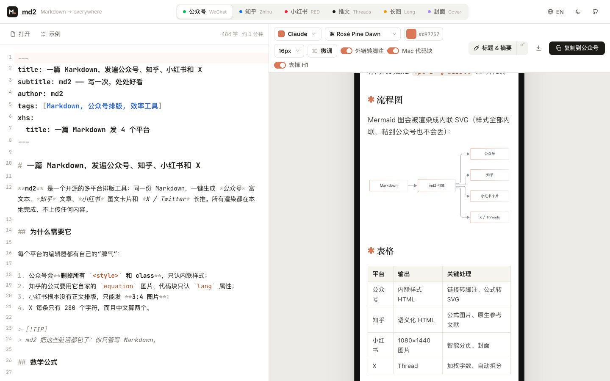

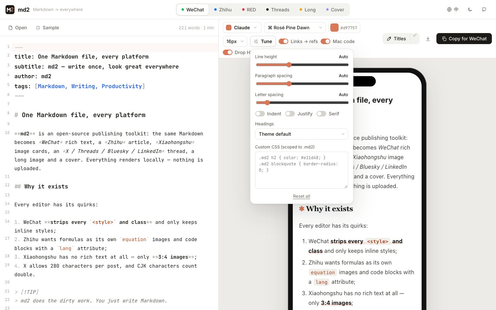

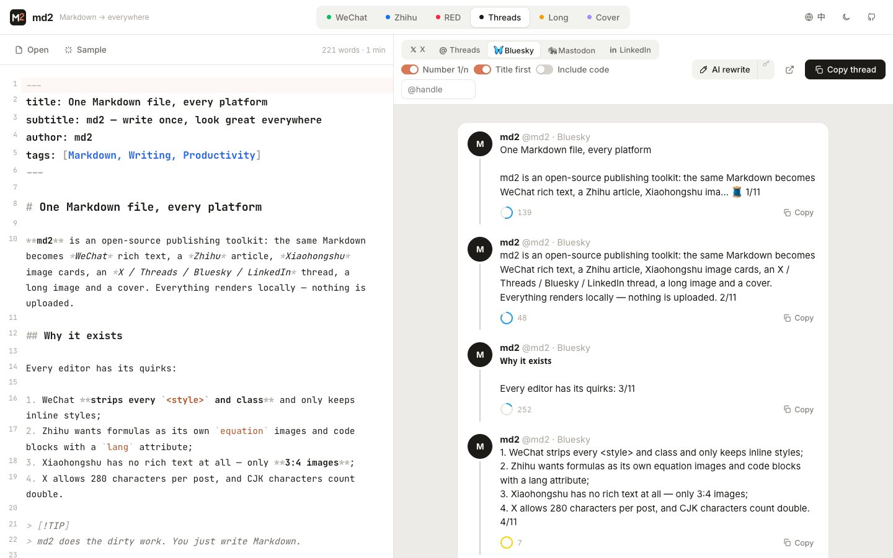

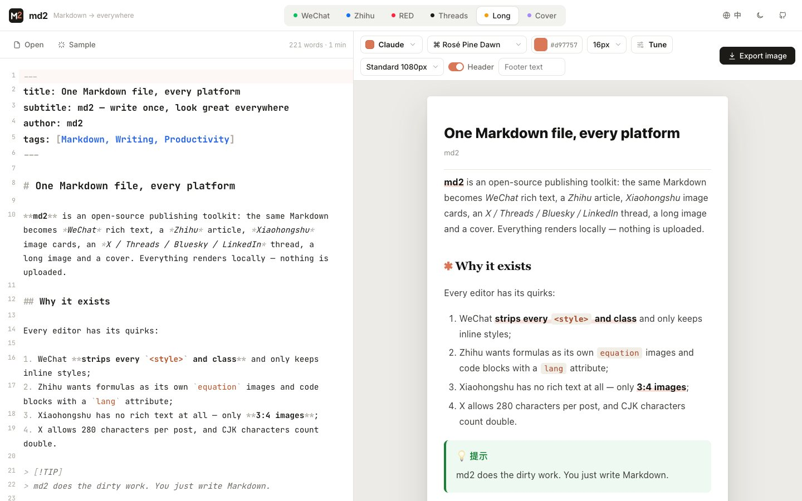

## Getting started

### VS Code extension

Install [md2 from the VS Code Marketplace](https://marketplace.visualstudio.com/items?itemName=brycewang-stanford.md2) (search **md2** in the Extensions view, or run `code --install-extension brycewang-stanford.md2`). Cursor, VSCodium and Windsurf users can install it from [Open VSX](https://open-vsx.org/extension/brycewang-stanford/md2). A `.vsix` is also attached to each [release](https://github.com/brycewang-stanford/md2/releases). Open any Markdown file, then click the md2 icon in the editor title bar or press <kbd>⌘</kbd><kbd>⌥</kbd><kbd>M</kbd> (Windows / Linux: <kbd>Ctrl</kbd><kbd>Alt</kbd><kbd>M</kbd>):

- Live preview for every platform, scrolling with your editor.
- From the Command Palette or the right-click menu: copy for WeChat / Zhihu, export Xiaohongshu cards, long images or covers (saved to `md2-export/`), copy a thread.
- **Publish to WeChat drafts** (your AppID / AppSecret are kept in VS Code's encrypted SecretStorage).
- **Zhihu Word export:** images in an unpushed or private repo have no public URL, so Zhihu can't fetch them from a paste. The Zhihu tab's **Export Word** button (or `md2 zhihu --docx out.docx`) saves a `.docx` with every image embedded; import it with 导入 → 导入文档 on Zhihu's write page.

<p>
  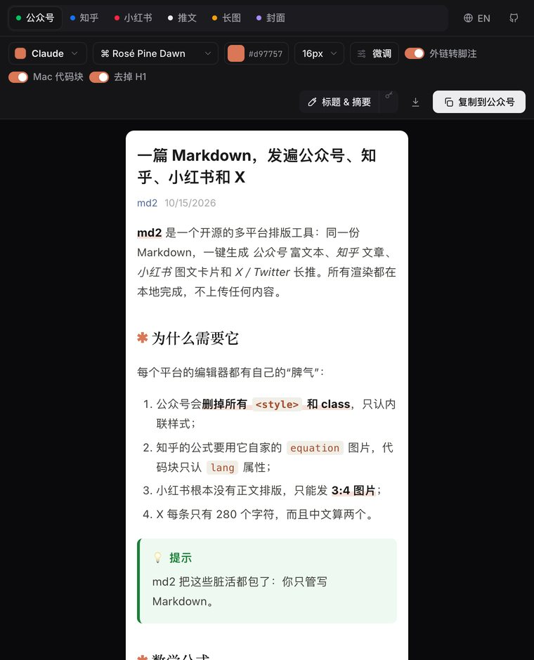
  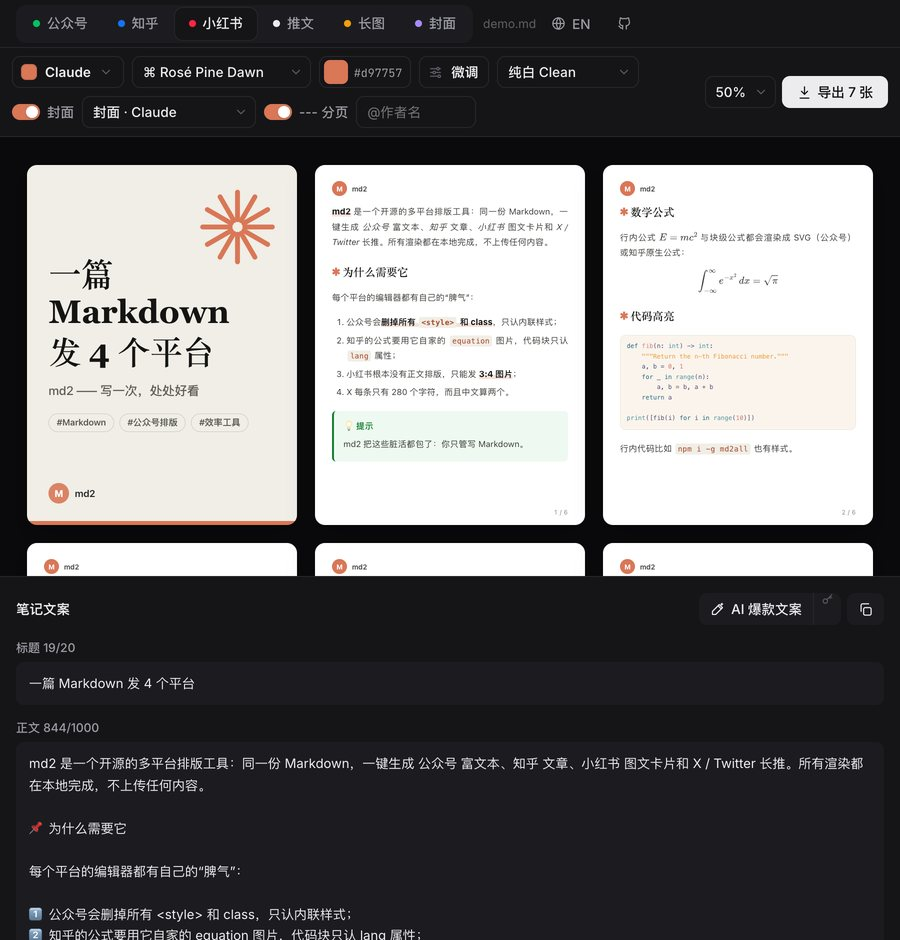
</p>

See the [extension README](apps/vscode/README.md) for every command and setting.

### Web App

Open **https://brycewang-stanford.github.io/md2/**. Write Markdown on the left (you can drop in a `.md` file or paste images) and switch platforms on the right:

- **WeChat**: click **Copy for WeChat** and paste into the WeChat Official Account editor.
- **Zhihu**: click **Copy for Zhihu** and paste into [the article editor](https://zhuanlan.zhihu.com/write). Formulas and code blocks stay editable.
- **Xiaohongshu**: click **Export N cards** to download a ZIP (images + `caption.txt`). Click the title or body on the right to copy it.
- **X**: copy posts one at a time, or the whole thread at once.
- **Cover**: pick a template and size, then export a PNG, or export every size at once.

Local development:

```bash
pnpm install
pnpm dev          # http://localhost:5173
```

### CLI

```bash
git clone https://github.com/brycewang-stanford/md2 && cd md2
pnpm install && pnpm build
cd packages/cli && npm link && cd -   # global `md2` command (once the md2all npm package is published: npx md2all)

md2 wechat post.md --copy -t claude        # WeChat rich text → clipboard
md2 zhihu  post.md --copy                  # Zhihu rich text → clipboard
md2 xhs    post.md -o out/xhs -s bento     # Xiaohongshu cards + caption.txt
md2 thread post.md -p x                    # X thread (-p threads|bluesky|mastodon|linkedin)
md2 long   post.md -t claude               # long image
md2 ai xhs post.md                         # AI Xiaohongshu title / caption (needs ANTHROPIC_API_KEY)
md2 cover  post.md -s wechat -t aurora     # WeChat header image
md2 cover  post.md --all -s xhs            # render every cover template at once
md2 themes                                 # list all themes / card styles / covers / sizes
```

Image commands (`xhs`, `long`, `cover`) render with your local Chrome or Edge. You can also run `npx playwright install chromium`, or point `MD2_CHROME_PATH` at a browser.

#### Publish straight to WeChat drafts

```bash
export MD2_WECHAT_APPID=wx...
export MD2_WECHAT_SECRET=...
md2 publish wechat post.md -t linear       # upload body images → upload/generate cover → create draft
md2 publish wechat post.md --dry-run       # rehearse without calling the API
```

Add your machine's outbound IP to the whitelist under **Settings & Development → Basic Configuration** (设置与开发 → 基本配置) in the WeChat Official Account platform. md2 only **creates drafts**. It never mass-sends. Common error codes (40164 IP not whitelisted, 48001 API not authorized, and others) come with an explanation.

### Front matter

```yaml
---
title: Article title         # falls back to the first H1
subtitle: Subtitle           # used on covers
author: Author
tags: [AI, Productivity]     # Xiaohongshu / X hashtags, cover chips
description: Summary         # WeChat digest, first post of a thread
cover: ./cover.png           # WeChat cover (else the first image, else generated)
xhs:
  title: Xiaohongshu title, ≤20 characters
---
```

Extended syntax: GFM tables / task lists / strikethrough, `$inline$` and `$$block$$` math, footnotes `[^1]`, GitHub-style alerts `> [!TIP]`, and embedded HTML.

## MCP / AI agents

md2 ships an MCP server so Claude, Cursor and other agents can typeset and render images directly:

```json
{
  "mcpServers": {
    "md2": { "command": "node", "args": ["/path/to/md2/packages/cli/dist/cli.js", "mcp"] }
  }
}
```

(Once the npm package is published, use `"command": "npx", "args": ["-y", "md2all", "mcp"]`.)

Tools: `md2_wechat`, `md2_zhihu`, `md2_thread`, `md2_xhs_cards`, `md2_long_image`, `md2_cover`, `md2_ai`, `md2_publish_wechat_draft`, `md2_list_styles`.

Claude Code users can also use the skill in this repo: `skills/md2/SKILL.md`.

## Architecture

```
packages/core   @md2/core  isomorphic rendering engine (browser + Node)
  parse         unified / remark / rehype → hast (front matter, GFM, math, alerts)
  inline-css    CSS inliner built on PostCSS + hast-util-select (WeChat)
  article       formula SVG (MathJax), code highlighting (lowlight), heading decoration, footnotes & references
  platforms/    wechat · zhihu · xhs · x
  cover/        10 cover templates
  dom.ts        Xiaohongshu paginator & cover title fitting (browser; the CLI reuses it via headless Chromium)
packages/cli    md2all     CLI + MCP server + WeChat API
apps/web        Web App (React + CodeMirror 6), also embedded in the VS Code webview
apps/vscode     VS Code extension (preview panel, commands, SecretStorage, draft publishing)
```

Xiaohongshu pagination and covers run **the same DOM code** in the web app and the CLI, so both export identical images.

```bash
pnpm build && pnpm test
```

## Roadmap

- [x] Mermaid diagrams · AI writing assistant · VS Code extension · long images · Threads / Bluesky / LinkedIn
- [ ] Browser autofill for Zhihu / Xiaohongshu (Playwright, with saved login)
- [ ] Theme marketplace: import / share custom themes
- [ ] Obsidian plugin (reusing `@md2/core`)

Issues and PRs are welcome, in English or Chinese.

## Also from the author: StatsPAI

<p align="center">
  
  &nbsp;&nbsp;&nbsp;&nbsp;
  <a href="https://doi.org/10.21105/joss.10604"></a>
</p>

[**StatsPAI**](https://github.com/brycewang-stanford/StatsPAI) is an agent-native Python library for causal inference and applied econometrics, a Python-first replacement path for Stata / R workflows (`regress`, `reghdfe`, `csdid`, `rdrobust`, `synth`, `DoubleML`, `esttab` and more), with machine-readable schemas and an MCP server for Claude Code, Claude Desktop and Cursor. It is developed and maintained by the **Stanford REAP** team (Rural Education Action Program, Center on China's Economy & Institutions).

[](https://pypi.org/project/StatsPAI/)
[](https://doi.org/10.21105/joss.10604)

```bash
pip install statspai
```

StatsPAI is published in the *Journal of Open Source Software*: Wang & Rozelle (2026), 11(125), 10604, [doi:10.21105/joss.10604](https://doi.org/10.21105/joss.10604).

```bibtex
@article{wang2026statspaijoss,
  author  = {Wang, Biaoyue and Rozelle, Scott},
  title   = {StatsPAI: A Unified, Agent-Native Python Toolkit for
             Causal Inference and Applied Econometrics},
  journal = {Journal of Open Source Software},
  year    = {2026},
  volume  = {11},
  number  = {125},
  pages   = {10604},
  doi     = {10.21105/joss.10604},
  url     = {https://doi.org/10.21105/joss.10604}
}
```

## License

[MIT](LICENSE) © Bryce Wang and contributors. See [NOTICE](NOTICE) for acknowledgements.
