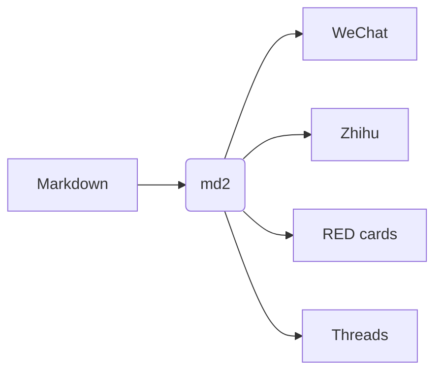

# One Markdown file, every platform

**md2** is an open-source publishing toolkit: the same Markdown becomes *WeChat* rich text, a *Zhihu* article, *Xiaohongshu* image cards, an *X / Threads / Bluesky / LinkedIn* thread, a long image and a cover. Everything renders locally — nothing is uploaded.

## Why it exists

Every editor has its quirks:

1. WeChat **strips every `<style>` and class** and only keeps inline styles;
2. Zhihu wants formulas as its own `equation` images and code blocks with a `lang` attribute;
3. Xiaohongshu has no rich text at all — only **3:4 images**;
4. X allows 280 characters per post, and CJK characters count double.

> [!TIP]
> md2 does the dirty work. You just write Markdown.

## Math

Inline math like $E = mc^2$ and display math render as SVG (WeChat) or native formulas (Zhihu):

$$
\int_{-\infty}^{\infty} e^{-x^2}\,dx = \sqrt{\pi}
$$

## Code

```python
def fib(n: int) -> int:
    """Return the n-th Fibonacci number."""
    a, b = 0, 1
    for _ in range(n):
        a, b = b, a + b
    return a
```

## Diagrams



## Tables

| Platform | Output | Key trick |
| --- | --- | --- |
| WeChat | Inline-styled HTML | Links → references, math → SVG |
| Zhihu | Semantic HTML | Native equations & references |
| Xiaohongshu | 1080×1440 PNGs | Smart pagination, cover |
| X / Threads | Thread | Platform-accurate counting |

> [!WARNING]
> WeChat articles can't link out, so md2 turns links into numbered references.

Read more on [GitHub](https://github.com/brycewang-stanford/md2). Footnotes work too[^1].

---

## Wrap-up

Writers should focus on writing. md2 handles the rest.

[^1]: Footnotes and links share one reference list.
